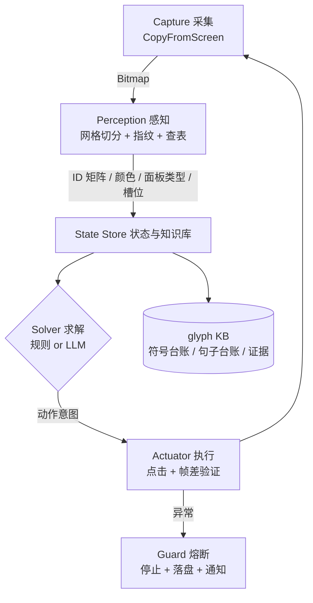

# 交接文档：外星语言破解 Agent

> 目标游戏：`MessageFromAliens`（Steam 进程名 `MessageFromAliens`）
> 本文是**预研 + 交接**，不含实现代码。实现请在新工程中进行。
> 编写依据：4 张笔记页截图 + 2 张测验页截图 + 用户口述机制 + 本机实测环境。

---

## 0. 目标与非目标

### 目标
让 LLM **自己破解**游戏里的外星符号系统，并通过点击自动完成游戏内的填空题，从而持续推进关卡。

### 非目标（明确排除）
- ❌ 不使用游戏的「点击译文→输入框」功能。记录由 Agent 自己在外部维护（更可控、更利于观察模型能力）。
- ❌ 不读游戏内存、不改存档、不逆向资源包。
- ❌ 不做"人肉宏"：每步决策必须来自感知结果 + 模型推理。

### 一个必须坚持的设计原则
**感知层要"笨"，求解层才"聪明"。**
感知层只做机械工作（切格、指纹、查表），**不允许夹带任何语义猜测**；所有"这个词是什么意思"的判断都必须由 LLM 给出并留痕。否则测的就不是模型能力了。

---

## 1. 环境事实（已实测，可直接依赖）

| 项目 | 实测值 | 意义 |
|---|---|---|
| 主屏 / 左屏 | `DISPLAY1` 1920×1080 @ (0,0) | 游戏所在屏，坐标系原点即屏幕左上角 |
| 副屏 | `DISPLAY2` 1920×1080 @ (1920,0) | 不参与 |
| 游戏窗口 | `L=0 T=0 R=1920 B=1080`，客户区原点 `(0,0)` | **无边框全屏窗口**（非独占全屏）→ GDI 截屏可用 |
| DPI | `GetDpiForWindow = 96` | 100% 缩放，**无坐标偏移风险** |
| 进程 | `MessageFromAliens`，PID 可变 | 用于激活窗口 / 校验存活 |

**推论：截图坐标 == 点击坐标 == 屏幕像素坐标，一律 1:1，无需换算。**

### 截屏失败的处理（用户明确要求）
> 截不到图（黑屏 / 窗口丢失 / 全黑帧） → **立即停止整个循环**，把最后一帧与错误信息落盘，通知用户来配置。**不重试、不猜测、不盲点。**

---

## 2. 游戏交互机制（用户口述 + 截图确认）

### 2.1 点击放置
1. 点击顶部候选符号区里的某个符号 → 它被选中
2. 点击目标**槽位**（带彩色/棕色描边的空框）→ 符号放入该槽位

### 2.2 反馈
- **没有逐题反馈**，也没有动画
- **全部槽位填对后**，画面顶部出现「正确」标记符号
- 因此闭环验证点只有一个：**整题完成时**

### 2.3 题型（已见）
- 笔记页：符号 + 玩家注释（我们不用）
- **测验页**：算式填空，例如
  ```
  5  减  2(2)  =  3(3)
  1  加  2(2)  =  3(3)
  ```
  顶部有 `order?` / `测验` / `n (n)` / `正确?` 之类的区头

### 2.4 已确认的语言事实（来自前面 4 张笔记页）
- 数字 = **一元竖线计数**：`|`=1，`|||`=3；0 是「方框内四点」的特殊形
- `加` / `减` / `=` 是独立符号
- 符号存在**复合构造**规律（如「长度单位」= 「长度」的加强形）
- 分类层级：大分类 → 小分类 → 主题符号；**新词用已学词定义**
- 已知符号库：43 个 ID（见 `translations.csv` 与 `out/thumb/*.png`）

---

## 3. 架构



六个模块：

| 模块 | 职责 | 依赖 |
|---|---|---|
| Capture | 截屏、窗口校验、稳定帧判定 | .NET `System.Drawing` |
| Perception | 面板分类、行列切分、符号识别、颜色识别、槽位检测 | 复用现有 `common.ps1` 思路 |
| State Store | 当前面板结构、符号台账、句子台账、假设与证据 | 文件/SQLite |
| Solver | 解析算式、推断词义、决定下一步动作 | 规则引擎 + LLM |
| Actuator | 点击、点击后验证 | `user32.dll` |
| Guard | 熔断、日志、异常上报 | — |

---

## 4. 各模块设计要点

### 4.1 Capture
- **双通道（已实测）**
  | 方法 | 前提 | 实测结果 |
  |---|---|---|
  | `GDI`（`CopyFromScreen`） | 必须前台 | 前台时正常，画面精确 |
  | `PrintWindow(PW_RENDERFULLCONTENT)` | **可后台** | **验证通过**：前台是 VS Code 时仍能截到完整游戏画面 |
  | `Auto`（默认） | — | 前台走 GDI，后台走 PrintWindow |
- 每帧先做**存活校验**：窗口 rect 是否仍为 1920×1080；像素缓冲里亮像素数 ≥ 400 且颜色种类 ≥ 4
  - ⚠️ 不能用稀疏 `GetPixel` 采样：本游戏笔画极细，隔 40px 采样会全落在黑底上，把正常画面误判成黑屏
- 稳定帧判定：连续两帧差异像素占比 < 0.1%（本游戏无动画，通常首帧即稳定）
- 每步落盘一帧 PNG（`runs/<timestamp>/step-0001.png`），便于事后复盘

### 4.2 Perception
复用已验证的管线，改造点如下：

| 能力 | 现状 | 改造 |
|---|---|---|
| 分隔线剥离 | 覆盖率≥90% + 厚度≤6 + 隔离校验 | 直接复用 |
| 行布局（字形行 + 文字行配对） | 已实现，4 张图 100% 正确 | 直接复用；但**测验页没有文字行**，需按固定 y 网格兜底 |
| 列切分 | 文字标签中心作网格标尺 | 测验页无标签 → 用**固定网格标定**（一次人工标定 + 锚点校验） |
| 符号指纹 | 24×24 block-max + RMS + ±1 平移容差 | 直接复用 |
| **聚类 → 分类** | 当前是聚类（无监督） | **改为最近邻查表**：对已知库求最小距离，输出 `{id, dist, margin}` |
| 置信度策略 | 无 | `dist < 0.08` 高置信；`0.08–0.11` 存疑（记录但不用于推理）；`> 0.11` 判为新符号 → 登记为新 ID 并请模型命名 |
| 颜色识别 | 无 | 色块中心 5×5 均值 RGB → 与标定表做 RGB 欧氏距离分桶（**不用颜色名，避免色觉差异影响**） |
| 槽位检测 | 无 | 待标定：首次人工点一个空槽位，记录描边色 RGB 中位数；之后按「该色 ± 阈值」找矩形轮廓 |
| 面板分类 | 无 | 顶部区头锚点模板匹配（`order?`/`测验`/`设置`/`笔记` 等），或用固定布局 + 少量锚点校验 |

**双通道感知（建议）**：除指纹外，把整行放大图（`out/lines/*.png` 那种）作为**图像**一起喂给多模态模型，让模型同时获得"符号身份"和"形状直觉"。指纹保证身份稳定，图像提供结构/相似性线索。

### 4.3 State Store（知识库）
三张表 + 一份日志：

```
glyphs(id, thumb_path, first_seen, meaning, confidence, evidence[])
sentences(id, panel, glyph_seq[], proposed_translation, status[unknown|hypothesis|verified])
assumptions(id, target_glyph_id, hypothesis, evidence, ts, model, outcome)
action_log(step, panel, action, before_frame, after_frame, changed)
```

**内置一致性约束（很重要）**：游戏保证「同形必同义」，所以
- 同一 ID 出现两种译文 → 报警
- 两个 ID 被赋予同一译文 → 报警
这两条是本项目最强的自动纠错器。

### 4.4 Solver
输入给模型的结构化上下文：
- 当前面板类型、整屏 ID 矩阵
- 未知 ID 列表 + 它们出现的句子（ID 序列 + 已译部分）
- 已知台账（ID → 译文）
- 允许的动作空间（点击候选符号、点击槽位、翻页/返回）

输出（必须 JSON）：
```json
{
  "hypotheses": [{"id": "g003", "meaning": "...", "evidence": "出现在「X is _ 的 轴」"}],
  "action": {"type": "click_slot", "slot": 2, "symbol_id": "g036"},
  "confidence": 0.72,
  "reason": "..."
}
```

工程要点：
- **状态哈希缓存**：同一 (面板, ID 矩阵) 不重复问模型
- **规则优先**：算式求解（已知数字/加/减/= 后）走确定性规则，不烧 token
- **失败回滚**：动作无效果 → 记录该动作无效 → 下次同状态换方案
- **思维留痕**：每步 `reason` 落盘，便于评估"模型到底会不会"

### 4.5 Actuator
```csharp
SetCursorPos(x, y);            // 屏幕坐标
mouse_event(LDOWN); mouse_event(LUP);
```
- **点击必须前台**。`mouse_event` / `SendInput` 走的是桌面输入队列，作用对象是"光标下的窗口 + 活动窗口"；游戏不在前台时点击会打到别的窗口上（危险且无效）。
- 动作前先 `SetForegroundWindow` 并**复核**；复核失败 → 停止并通知用户（Windows 会限制后台进程抢前台）。
- 备选（未验证）：`PostMessage(WM_LBUTTONDOWN/UP)` 可以绕过焦点，但 Unity/Unreal 类游戏常忽略该消息，需实测（列为 P1 实验项）。
- 点击前先 `SetForegroundWindow` 激活游戏
- 点击后立刻抓一帧，与点击前做 diff：**无变化 → 该动作无效**（记入日志，重试 1 次，仍无效则熔断）
- 点击间隔 ≥ 120ms（虽然无动画，但要给 UI 响应时间）

### 4.6 Guard
- 全局最大步数（默认 300）
- 连续 N 次（默认 3）动作无效 → 停止
- 截屏失败 / 窗口尺寸变化 / 全黑帧 → 立即停止
- 停止时输出：当前帧、最近 5 步动作日志、当前知识库快照

---

## 5. 关键技术决策

| 决策 | 选择 | 理由 |
|---|---|---|
| 识别方式 | 自研指纹匹配 | 游戏字体是自造符号，OCR/现成模型都无解；指纹在同一符号上实测距离 0.00–0.10，异符号 0.13–0.57，分得很开 |
| 网格定位 | 笔记页用文字标签当标尺 | 4 张图实测「标签段数 == 符号数」100% 命中 |
| 测验页定位 | 固定网格标定 + 锚点校验 | 测验页没有文字标签可当标尺 |
| 译文输入 | 完全不用 | 目标与模型能力测试；外部记录更可控 |
| 剪贴板方案 | 备选，优先级最低 | 若将来必须键盘输入：`Set-Clipboard` + `SendInput(Ctrl+V)`。但游戏内输入框接受的是**外星字形**，粘中文没意义 |
| 颜色 | RGB 距离分桶 | 用户对棕色不敏感 → 不依赖人眼命名，一切以程序采样为准 |
| 语言 | PowerShell 复用现有代码（可选 Python 辅助） | 现有管线是 PowerShell，迁移成本最低；OpenCV/BFS 可后置 |

---

## 6. 风险与对策

| # | 风险 | 影响 | 对策 |
|---|---|---|---|
| 1 | 槽位描边色/位置标定不准 | 点空、无效动作 | 首次人工标定 + 每轮锚点校验 + 动作后帧差验证 |
| 2 | 测验页布局与笔记页不同 | 切格错位 | 面板分类先行；测验页单独一套网格参数 |
| 3 | 新符号（库外） | 误判为已知 | 输出 `margin`；`dist > 0.11` 一律视为新符号并请模型命名 |
| 4 | 模型幻觉出"没出现过的词" | 台账污染 | 假设必须附证据（引用出现位置）；假设标 `hypothesis` 而非 `verified` |
| 5 | 关卡切换/新面板类型 | 状态机卡死 | 未知面板 → 截图存档 + 询问用户，不盲点 |
| 6 | 独占全屏导致黑屏 | 无法感知 | 已确认当前是无边框；黑屏即熔断并提示用户改窗口模式 |
| 7 | 点击误落到错误面板 | 破坏进度 | 只点白名单区域；点前确认面板类型 |
| 8 | LLM 成本/延迟 | 流程慢 | 状态哈希缓存 + 规则优先 |

---

## 7. 分阶段计划与验收标准

| 阶段 | 内容 | 验收标准 | 预估 |
|---|---|---|---|
| **P0 只读感知** | 截屏 + 面板分类 + 符号识别 + 输出 ID 矩阵 | 对 6 张已知截图，识别结果与人工台账 100% 一致 | 0.5–1 天 |
| **P1 点击原语** | 激活窗口 + 单点 + 帧差验证 | 能可靠点中「返回」并检测到面板变化；10 次 10 中 | 0.5 天 |
| **P2 槽位与配对** | 槽位检测 + 候选符号识别 | 能输出「候选符号 ID → 屏幕坐标」与「槽位 → 坐标」列表 | 1 天 |
| **P3 算式求解闭环** | 已知数字/加/减 → 规则求解 → 点击填满 → 检测「正确」 | 测验页一题全自动做对 | 1–2 天 |
| **P4 LLM 求解** | 未知符号的语义推断 → 动作规划 | 无人工参与下推进 N 个面板；台账一致性零冲突 | 视情况 |

**建议先做 P0**：不碰鼠标、不改游戏，风险为零，且能立刻验证"眼睛"是否可靠。

---

## 8. 迁移清单（新工程需要带走的资产）

从当前 `d:\github\test\glyphs\` 迁出：

```
src/vision/common.ps1        # 读图 / 亮度表 / 行带 / 网格 / 指纹 / 分隔线剥离
src/vision/classify.ps1      # 由 dedupe.ps1 改造：聚类 → 最近邻查表
data/translations.csv        # 43 条已知符号译文
data/symbols/thumb/g0xx.png  # 43 个符号缩略图（符号库）
data/clusters.json           # 指纹向量库（分类器的权重）
docs/HANDOFF.md              # 本文档
```

建议的新工程结构：

```
agent/
  src/
    capture/        # 截屏、存活校验、稳定帧
    vision/         # 网格、指纹、分类、颜色、槽位
    state/          # KB + 一致性校验
    solver/         # 规则引擎 + LLM 客户端 + 提示词
    act/            # 点击、帧差验证
    guard/          # 熔断、日志
    main.ps1        # 状态机主循环
  data/             # 符号库、台账
  runs/             # 每轮截图与动作日志
  tools/            # 标定工具（人工点一次，记录坐标/颜色）
```

---

## 9. 待确认 / 未知项（实现前需要补的）

1. **空槽位截图**：需要一张"题还没填完"的图 —— 用来标定槽位描边色与几何
2. **「正确」标记符号**：需要一张"已通关"的图 —— 用作成功检测模板
3. **候选符号区范围**：顶部候选条的固定像素范围（一次标定即可）
4. **是否有多种题型**：除算式填空外还有别的测验形式吗？
5. **面板导航图**：`返回` / `笔记` / `设置` / `测验` 之间的可达关系
6. **关卡推进条件**：做完一题自动下一题？还是要手动切换小分类？

---

## 10. 一句话总结

技术上没有硬障碍：**坐标系干净（1:1 像素）、UI 无动画、识别管线已跑通 43 个符号**。
真正的难点是两件事 ——**槽位/成功标志的标定**，以及**让模型在有噪声的感知结果上稳定推理而不幻觉**。
建议按 P0 → P1 → P2 → P3 的顺序推进，每阶段都有可验证的产出。
